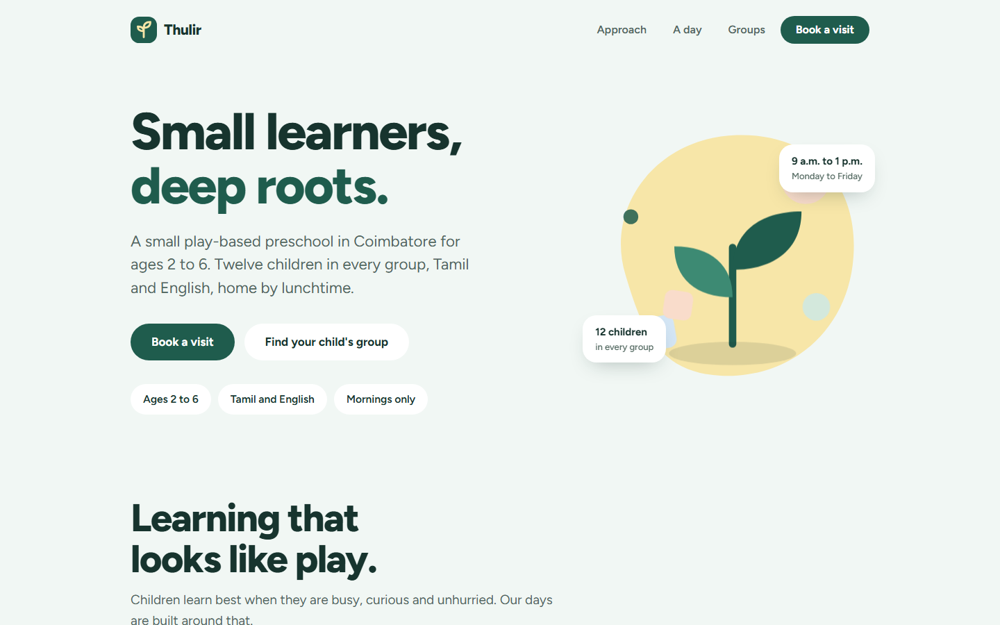
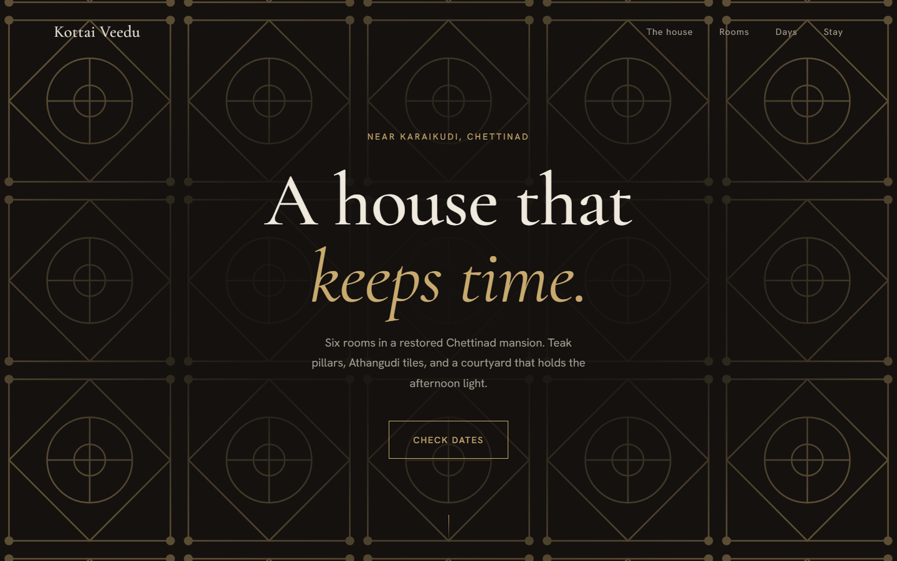
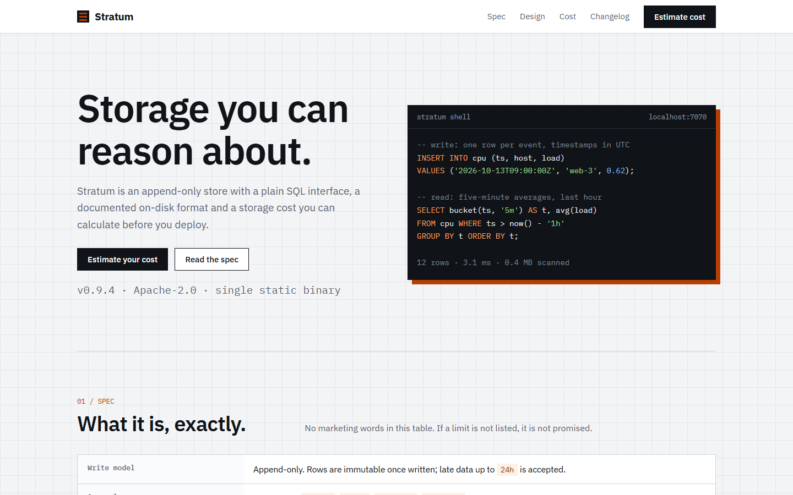
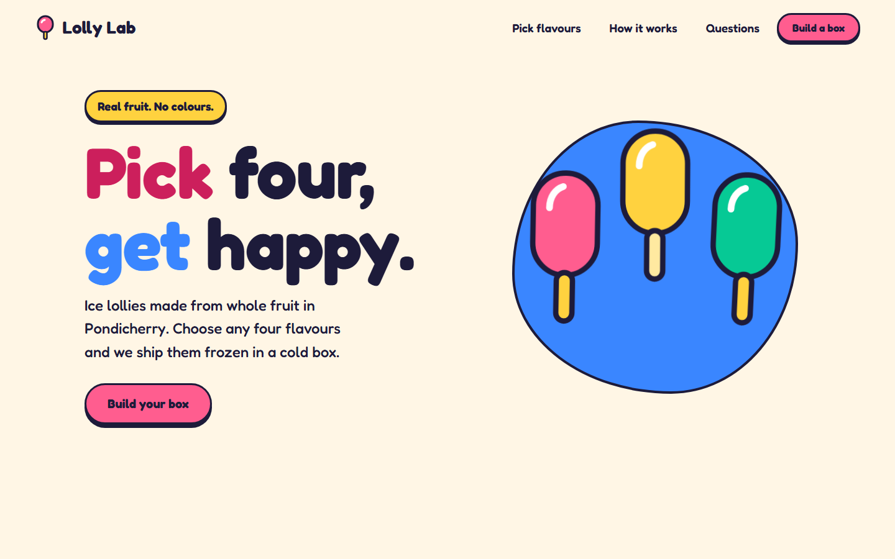
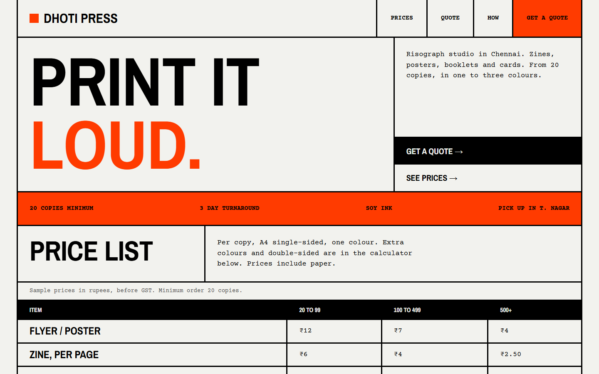
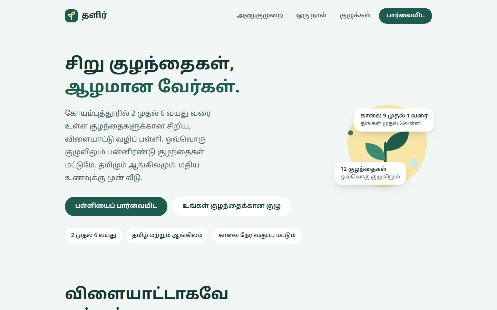

<div align="center">

# ui-craft

**Agent skills that make web UI decided, complete and measured.**

A design method, a redesign method for existing projects, and a completeness guard,<br>
plus two dependency-free scripts that check the result in a real browser.


</div>

## Install

```bash
npx skills add Siyana158/ui-craft-skills
```

Run it from the root of your project. It copies four skills into `.agents/skills/`, links them for the tools it detects, and records the source in `skills-lock.json`. Start a new session afterwards so the skills are listed.

| You need | For |
|---|---|
| Node 18+ | installing, and `lint.mjs` |
| Node 22+ and any installed Chrome, Edge or Chromium | `inspect.mjs` |

Works with any agent that reads `SKILL.md` skills (see the `skills` CLI for supported tools).

**Try it.** After installing, ask in plain language: *"build a landing page for a small bakery"*. The agent should write a brief card, a tokens file and the copy first, then build the page, then run the inspector and show screenshots.

**Update or remove.** Re-run the install command to update. To remove, delete the four folders from `.agents/skills/` and the matching entries in `skills-lock.json`.

**Without the installer.** Copy `skills/*` into your tool's skills folder by hand, or clone the repo and run the scripts directly.

Skills can run commands with your agent's permissions. Read `skills/*/SKILL.md` and the two scripts before first use.

## Examples

Eight pages: seven directions and a Tamil version, one method. Each is a single file: open it directly in a browser. All names, prices and addresses are made up.

<table>
<tr><td width="50%" valign="top"><a href="examples/kettle-and-co/index.html"></a><br><b>Kettle &amp; Co.</b><br><sub>Editorial bold, brew timer</sub></td><td width="50%" valign="top"><a href="examples/kora/index.html"></a><br><b>Kora</b><br><sub>Modern product (dark), savings simulator</sub></td></tr>
<tr><td width="50%" valign="top"><a href="examples/thulir/index.html"></a><br><b>Thulir</b><br><sub>Soft light, group finder by age</sub></td><td width="50%" valign="top"><a href="examples/kottai/index.html"></a><br><b>Kottai Veedu</b><br><sub>Quiet luxury, stay estimate</sub></td></tr>
<tr><td width="50%" valign="top"><a href="examples/stratum/index.html"></a><br><b>Stratum</b><br><sub>Technical grid, storage cost calculator</sub></td><td width="50%" valign="top"><a href="examples/lollylab/index.html"></a><br><b>Lolly Lab</b><br><sub>Playful, build-a-box picker</sub></td></tr>
<tr><td width="50%" valign="top"><a href="examples/dhotipress/index.html"></a><br><b>Dhoti Press</b><br><sub>Raw / utilitarian, print quote calculator</sub></td><td width="50%" valign="top"><a href="examples/thulir-tamil/index.html"></a><br><b>Thulir (Tamil)</b><br><sub>Indic typography, same page in Tamil</sub></td></tr>
</table>

## Why

A page made on autopilot is the average of every page seen before. ui-craft replaces that with a short chain where each stage leaves something you can point at, and where the result is measured in a browser instead of assumed.

**brief → tokens → weight map → copy → build → measure → look → report**

## The skills

| Skill | Use it when | What it does |
|---|---|---|
| **`web-ui-design`** | building or polishing a page or component | Brief card, specificity ledger, tokens first, weight map, copy before markup, build, motion pass, **measure**, **look**, report |
| **`ui-redesign`** | improving UI that already exists | Baseline screenshots, five-lens triage, change tiers from tokens up to layout, replacement guide, before/after proof |
| **`complete-output`** | you need full files and no shortcuts | Delivery list, banned shortcuts, close-out ledger with verified / not verified per item, clean split protocol |
| **`indic-typography`** | Tamil or other Indic text on the page | Font stacks, line-height and spacing for Tamil, headline fitting, mixed-language rules, form fonts, and inspector checks for all of it |

Ask in plain language ("build a landing page for my bakery", "this dashboard looks generic, fix it", "write the whole file, no placeholders") and the matching skill is picked up from its description.

## The scripts

They live in `skills/web-ui-design/scripts/`. They need Node 22+ and any installed Chrome, Edge or Chromium. Nothing is installed from npm.

```bash
# scan source for placeholder text, cliche copy, dead links, missing alt, vh and easing mistakes
node skills/web-ui-design/scripts/lint.mjs ./src

# open the page at 1440 / 768 / 390 px, measure it, save full-page screenshots
node skills/web-ui-design/scripts/inspect.mjs ./index.html
node skills/web-ui-design/scripts/inspect.mjs http://localhost:3000 --strict

# compare before/after screenshots with an interactive split slider, side-by-side and blend views
node skills/web-ui-design/scripts/diff.mjs --before .ui-craft/baseline --after .ui-craft/inspect
```

Sample output:

```text
fonts loaded: Bricolage Grotesque
screenshot: .ui-craft/inspect/1440.png
screenshot: .ui-craft/inspect/768.png
screenshot: .ui-craft/inspect/390.png
WARN [imagery] 0 real pictures/videos on the page; strong pages usually carry 4 or more (1440px)
WARN [tap-targets] targets under 44px: Kettle & Co., Shop (390px)

0 FAIL, 6 WARN. Open the screenshots and critique them: the meter only measures what is measurable.
```

`inspect.mjs` checks, per viewport: horizontal overflow, headline line counts, WCAG AA contrast, font families actually loaded, missing form labels and alt text, tap targets, `h1` / title / lang / description, focus styles, reduced-motion handling, DOM tree depth & node counts, layout shift (CLS), number of real pictures, number of animated elements. It exits `1` on any `FAIL`.

By default only objective checks run. `--strict` adds opinionated taste checks (monospace, tiny tracked caps, gradients, resting shadows). `--allow rule,rule` silences a rule you accept. `diff.mjs` outputs an interactive `.ui-craft/diff.html` viewer.

## Documentation

- [Getting started](docs/getting-started.md): install, requirements, first use
- [Skills reference](docs/skills.md): every stage of every skill
- [Scripts reference](docs/scripts.md): every rule, exit codes, CI example
- [Health checks](docs/health-checks.md): layout, accessibility, keyboard and reduced-motion checks
- [Indic typography](docs/indic-typography.md): Tamil and other Indic text
- [FAQ](docs/faq.md): common problems

## Design stance

- Objective rules are enforced; taste is opt-in.
- Every stage leaves an artifact (brief, tokens, copy, report). No artifact, no stage.
- Measurements are necessary, never sufficient: looking at the screenshots is a required stage.
- No invented proof: no fake customers, quotes, press or statistics.

## Credits

Skills for design quality have been explored by others, notably [taste-skill](https://github.com/Leonxlnx/taste-skill). ui-craft is an independent work with its own structure, text and scripts; no text or code was copied from it.

## License

[MIT](LICENSE)
